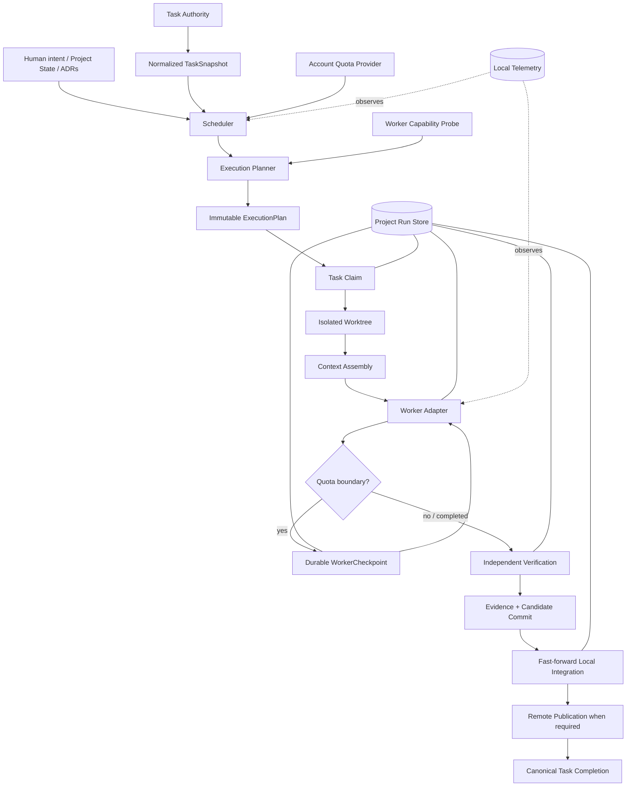

# ProjectCTL Blueprint

Status: **Canonical high-level product, architecture, and roadmap reference**

Last architecture review: **2026-10-04**

This document answers four questions:

1. What is ProjectCTL ultimately trying to become?
2. Which component is authoritative for each kind of state?
3. What architecture and safety invariants must future work preserve?
4. What is implemented now, what is deliberately not implemented, and what should happen next?

It is intentionally different from the README and ADRs:

- `README.md` is the user-facing implementation guide and milestone history.
- `docs/PROJECT_STATE.yaml` is the **only authority for the active goal and active milestone**.
- ADRs are the authority for individual architecture decisions. A newer accepted ADR overrides
  a conflicting statement here and this blueprint must then be updated.
- This blueprint is the authority for the **overall product direction, architecture map, invariants,
  and roadmap shape**.

Do not create a second roadmap, task tracker, or execution-state authority beside these sources.

---

## 1. Product vision

ProjectCTL is a:

> **local-first, Git-native, task-centric, evidence-driven, quota-aware control plane for
> AI-assisted software engineering.**

The final product is not an unconstrained autonomous coding agent.

It is a deterministic control plane that can take an existing or new software repository,
discover its existing authorities, choose bounded work, delegate implementation to one or more
worker providers, independently verify the result, integrate only proven changes, survive
interruptions, respect model quota, and keep humans in control of intent and policy.

The intended user experience is approximately:

```text
projectctl init / adopt
        ↓
discover project authorities and constraints
        ↓
inspect current project state
        ↓
select eligible task deterministically
        ↓
build immutable execution plan
        ↓
claim task
        ↓
create isolated worktree
        ↓
assemble bounded context
        ↓
run worker
        ↓
checkpoint safely if quota requires it
        ↓
independent verification
        ↓
create verified candidate commit
        ↓
integrate under control-plane policy
        ↓
publish when remote/team semantics require it
        ↓
complete canonical task
        ↓
refresh status / continue or stop
```

A future ProjectCTL may coordinate multiple projects and multiple workers, but only after the
single-project lifecycle is correct and observable.

---

## 2. Non-goals

ProjectCTL must not become:

- a second source of truth for requirements that already live elsewhere
- a hidden replacement for the configured task tracker
- an LLM-driven scheduler whose decisions cannot be reproduced
- a worker that verifies its own claims
- a daemon that consumes unbounded quota
- a system that silently rebases or rewrites verified code
- a credential store for external providers when supported provider tooling already owns auth
- a prompt wrapper that approximates provider features the adapter cannot actually guarantee
- a distributed coordinator before a real distributed ownership primitive exists

---

## 3. Authority map

Exactly one authority should exist for each mutable concern.

| Concern | Authority | Notes |
| --- | --- | --- |
| Product vision / high-level architecture / roadmap shape | `docs/PROJECTCTL_BLUEPRINT.md` | This document |
| Active goal / active milestone | `docs/PROJECT_STATE.yaml` | Structured, human-managed |
| Requirements / feature specification | Bound project specification sources | Spec Kit when configured; otherwise project bindings |
| Architecture decisions | `docs/decisions/ADR-*.md` | Newer accepted ADR wins on conflict |
| Task execution state / dependencies | Configured task authority | Beads and GitHub adapters implemented; exactly one provider per project |
| Source code and integration history | Git | Git state is never inferred from worker narration |
| Verification policy | `projectctl.verification.yaml` | Human-managed |
| Verification result / evidence | ProjectCTL run artifacts and Evidence manifests | Worker result alone is not evidence |
| Run lifecycle / leases / checkpoints | `.projectctl/state.sqlite` + run artifacts | Operational, project-instance-local |
| Quota observations / provider selection | `$PROJECTCTL_HOME/state.sqlite` | Account-global |
| Project quota policy | `.projectctl/config.yaml` | Local policy, not quota observation authority |
| Generated status dashboards | `docs/generated/*` | Derived and non-authoritative |
| Telemetry | `.projectctl/telemetry.sqlite` | Observational only |
| Graph data | Future derived Graphify integration | Must never become requirements/task authority |
| Obsidian or other UI | Future human cockpit | Must remain UI, not execution authority |

### Authority rule

If two systems can independently change the same semantic state, the architecture is wrong until
one is explicitly declared authoritative and the other is made derived, imported one-way, or
read-only.

This is why Spec Kit → Beads import is one-way, generated dashboards are non-authoritative, and
GitHub mutations are enabled only where ProjectCTL has explicit ownership, publication, and
non-destructive lifecycle semantics.

---

## 4. Core invariants

These are architecture constraints, not implementation preferences.

### 4.1 Human intent is a boundary

A change in project goal, active milestone, requirements, architecture policy, or protected
instructions is not ordinary worker input. Autonomous continuation must stop or replan.

### 4.2 Task and Run are different entities

A Task is durable project work owned by the configured task authority.

A Run is one ProjectCTL attempt to execute that task. A task may have many runs.

Run state must never silently become a second task tracker.

### 4.3 Scheduler and Execution Planner are separate

The scheduler ranks eligible work from normalized task state, project state, quota, and
deterministic policy.

Worker capability and execution strategy belong to the execution-planning layer, not task ranking.

### 4.4 Workers are not authorities

Workers may implement code and return structured results.

They may not authoritatively decide:

- which task is complete
- which files actually changed
- whether tests passed
- whether Git history is valid
- whether permissions may be expanded
- whether required verification may be weakened
- whether a task may be closed

### 4.5 Verification is independent

Required verification is selected by trusted ProjectCTL/human policy and runs independently of
worker self-report.

A task is not complete until the required evidence chain is valid.

### 4.6 Verified code is not silently transformed

A verified candidate is bound to its exact base and exact diff.

Integration is fast-forward-only today. If the target advances, ProjectCTL does not silently
rebase/cherry-pick the candidate and pretend the old evidence still applies.

### 4.7 Worker Git authority is intentionally narrow

Workers may modify the isolated workspace permitted by policy.

Workers may not commit, merge, rebase, push, or rewrite Git history. ProjectCTL owns control-plane
Git mutations.

### 4.8 Quota is account-global; policy is project-local

Quota observations belong to the provider account, not one repository.

Project policy may reserve or constrain that shared budget, but repositories must not maintain
independent fictional copies of account quota.

### 4.9 Unknown state fails closed

Unknown capability, stale quota, ambiguous recovery state, conflicting task metadata, unsafe path,
or unproven ownership must not be converted into optimistic execution.

### 4.10 Provider support is not adapter support

A provider feature is usable only when ProjectCTL has an adapter path whose semantics are tested
and compatible with ProjectCTL policy.

### 4.11 Context must be inspectable and bounded

Context assembly records authoritative paths and digests rather than dumping the entire project
into prompts.

Future context discovery may become smarter, but it must remain distinct from authority.

### 4.12 Autonomous execution is bounded

M2 deliberately implements a synchronous bounded loop, not an infinite daemon.

Quota checks, retry budgets, recovery-first behavior, and human-decision stops remain part of the
safety boundary.

---

## 5. Current architecture



The `Publish` stage is explicit because for a remote task authority such as GitHub,
**local Git integration is not the same thing as team-visible delivery**. M3.0c implements this
stage for GitHub with exact-base publication and durable remote observation.

---

## 6. Layer boundaries

### 6.1 Project layer

Responsibilities:

- initialize/adopt repositories
- discover existing project assets
- bind knowledge sources
- hold structured Project State
- protect human/tool/generated ownership boundaries

Must not:

- infer missing intent with an LLM
- rewrite existing project structure merely to fit ProjectCTL

### 6.2 Task-authority layer

Responsibilities:

- normalize provider-specific tasks into `NormalizedTask`
- read task state
- expose explicit supported lifecycle operations
- perform claim/release/block/complete only when semantics are proven

Provider-specific behavior must stay behind task-authority ports/resolvers.

Application services must not import Beads/GitHub/Linear/Jira implementations directly.

### 6.3 Scheduling layer

Responsibilities:

- deterministic eligibility
- deterministic scoring
- stable tie-breaking
- quota-aware model-profile recommendation
- milestone relevance from explicit metadata

Must not:

- mutate task state
- inspect provider credentials
- use worker capability to change task ranking
- invent quota or cost estimates

### 6.4 Execution layer

Responsibilities:

- immutable plan creation
- preflight revalidation
- canonical task claim
- worktree lifecycle
- execution policy
- worker capability/strategy validation
- durable run transitions

### 6.5 Worker layer

The worker boundary is provider-neutral.

Current implemented worker provider: **Codex**.

The stable adapter currently relies on documented supported surfaces. Provider features not
implemented by the adapter remain unsupported rather than prompt-emulated.

### 6.6 Verification and evidence layer

Responsibilities:

- protected-path checks
- deterministic configured commands
- workspace-stability checks
- evidence chain
- ProjectCTL-owned candidate commit

### 6.7 Integration/publication layer

Current local integration:

- exact-base validation
- evidence revalidation
- fast-forward only
- serialized shared-target mutation
- no worker Git mutation

Current remote-delivery behavior:

- task-authority delivery policy distinguishes local-only from publication-required delivery
- GitHub publication is exact-base and fast-forward-only to the configured target on `origin`
- PublicationRequest/PublicationManifest form a durable evidence chain
- remote target observation gates canonical completion
- GitHub completion is additive via `projectctl:completed`, preserving native human close reasons
- exact GitHub task claim is held through publication/completion and released afterward
- repositories whose rules reject direct target publication fail closed; M3.0c does not bypass
  rulesets or silently switch to pull-request delivery

For local-only task authorities such as Beads, local integration is sufficient under the current
delivery policy.

### 6.8 Runtime/recovery layer

Responsibilities:

- local leases
- lease heartbeat
- crash-safe project locks
- append-only run events
- deterministic recovery
- resumable quota checkpoints

Current locks and leases are project-instance-local unless a provider-specific distributed
primitive is explicitly introduced.

### 6.9 Telemetry/evaluation layer

Current telemetry is a local SQLite event stream.

It is useful for audit and later evaluation, but it is not yet a distributed tracing or OTLP
system and must not be described as one.

---

## 7. Runtime lifecycle today

The implemented lifecycle through M3.0c is:

```text
fresh state
  ↓
scheduler decision
  ↓
ExecutionPlan
  ↓
durable task claim
  ↓
isolated worktree
  ↓
ContextManifest + WorkerRequest
  ↓
Codex turn
  ├─ quota unsafe → interrupt → durable checkpoint → later resume same thread
  └─ implemented
         ↓
      VERIFYING
         ↓
 independent verification
         ↓
 verified candidate commit
         ↓
 READY_TO_INTEGRATE
         ↓
 ff-only local integration
         ↓
 publication required?
   ├─ no  → canonical task completion
   └─ yes → durable PublicationRequest
               ↓
            exact-base remote publication
               ↓
            remote candidate observation
               ↓
            durable PublicationManifest
               ↓
            canonical task completion
               ↓
            exact claim release
         ↓
 PASSED
```

Beads uses the local-only delivery path.

GitHub uses the distributed claim protocol from M3.0b2 and the publication-gated delivery path from
M3.0c. GitHub is execution-capable under this direct-publication policy, but repositories whose
rules require a pull request or reject direct target publication remain fail-closed.

---

## 8. Current implemented baseline

### M0 — deterministic control plane

Implemented:

- schemas/contracts
- project bootstrap and doctor
- Beads task reader/import integration
- adaptive brownfield onboarding
- deterministic scheduler and quota-aware model profiles
- structured Project State
- generated status dashboards

### M1 — safe single-run execution

Implemented:

- immutable execution contracts
- claims and durable Run Store
- isolated external worktrees
- Codex capability/strategy layer
- deterministic path-based context assembly
- stable Codex worker adapter
- independent verification and evidence
- ProjectCTL-owned candidate commits
- fast-forward integration
- deterministic recovery
- lease heartbeat and project integration locks

### M2 — bounded autonomy and quota safety

Implemented:

- bounded synchronous auto loop
- recovery-first orchestration
- bounded retry
- automatic official Codex quota observations
- account-global quota provider selection
- in-turn quota monitoring
- supported Codex interrupt/resume
- durable tamper-evident checkpoints

### M3.0a — GitHub read authority

Implemented:

- GitHub Issues read adapter
- GitHub repository discovery/pinning
- GitHub issue normalization
- scheduler/status reads against GitHub
- read-only doctor checks
- explicit execution fail-closed boundary
- additive config/onboarding schema versioning

### M3.0b1 — provider-neutral task authority boundary

Implemented:

- TaskAuthorityCapabilities v1
- one Task Authority resolver
- provider-neutral application task reads/claims/lifecycle completion access
- static adapter capability inspection
- CLI capability inspection
- architecture guard preventing direct task-provider imports in application services

### M3.0b2 — distributed GitHub claim ownership

Implemented:

- exact remote-ref claim/release CAS
- unique marker commit ownership
- durable TaskClaimRequest/TaskClaim evidence
- claim validation before worker start/resume
- partial-prepare crash recovery

### M3.0c — publication-gated GitHub delivery

Implemented:

- provider-neutral delivery policy and publisher port
- exact-base remote publication
- durable publication evidence/recovery
- additive non-destructive GitHub completion/decision markers
- publication-bound task completion
- publication proof independently revalidated by the GitHub completion adapter
- claim release only after remote delivery/task completion
- post-completion claim cleanup cannot rewrite canonical task semantics
- GitHub full execution gate enabled under the direct-publication policy

---

## 9. Architecture review findings — 2026-10-04

The M0–M2 core is coherent. The main risk is no longer the worker loop itself; it is extending the
system to external team authorities without weakening earlier invariants.

### Finding A — task provider abstraction was incomplete (resolved in M3.0b1)

The repository already defines `TaskStoreReader`, `TaskClaimer`, and
`TaskCompletionWriter` ports, but application code still directly imports and branches on Beads
in execution, integration, and terminal task reconciliation.

This is acceptable historical M1 code but is the wrong foundation for GitHub/Linear/Jira.

**Resolution:** M3.0b1 introduced one provider-neutral Task Authority resolver/capability layer,
and application services now depend on the ports rather than provider implementations.

### Finding B — GitHub issue mutation did not provide a claim CAS (claim ownership resolved in M3.0b2)

GitHub supports normal issue/label/assignee mutation, but those APIs do not provide ProjectCTL a
documented compare-and-swap ownership primitive.

Therefore labels/assignees alone must not be treated as an atomic claim.

M3.0b2 implements claim ownership with a reserved remote Git branch and exact Git
`--force-with-lease` semantics. Each claim points to a unique marker commit, making release
ownership-verifiable and ABA-safe. The claim request/result are also bound to durable run events.

This resolved claim/release ownership only at M3.0b2. M3.0c subsequently adds
publication-gated block/completion semantics.

### Finding C — local integration was insufficient for remote completion (resolved in M3.0c)

M1.4 local fast-forward integration alone was not team-visible delivery.

**Resolution:** M3.0c introduces a versioned TaskDeliveryPolicy plus durable
PublicationRequest/PublicationManifest artifacts. GitHub completion is allowed only after the exact
verified candidate is observed on the configured remote target.

ProjectCTL also avoids blind native Issue-state PATCHes. It records additive
`projectctl:completed` / `projectctl:needs-decision` markers so concurrent human close reasons
remain authoritative.

### Finding D — GitHub dependencies are currently absent

M3.0a deliberately leaves `dependencies=[]` and `blocks=[]` for GitHub Issues.

That means open GitHub issues without explicit ProjectCTL lifecycle labels can be scheduler-ready
even when a team models dependency elsewhere.

Before GitHub becomes a rich team authority, dependency/sub-issue/blocked-by semantics must be
normalized explicitly rather than parsed from prose.

### Finding E — autonomous execution remains single-active-run

M2 intentionally stops if multiple active runs exist.

Parallel execution and multi-agent orchestration are **not** implemented and should not be
described as current capabilities.

### Finding F — advanced context/skills/graph features are still future work

The architecture anticipated:

- Context Discovery separate from Context Assembly
- optional Graphify-derived code relationships
- a governed skill lifecycle
- research/hypothesis/experiment flows

The current repository implements deterministic Context Assembly only. These future capabilities
must not be assumed by scheduling or execution code.

### Finding G — telemetry is intentionally minimal

Telemetry is currently a local SQLite event log. OTLP/distributed tracing/evaluation infrastructure
is future work.

### Finding H — generated public schemas need an explicit drift policy

`projectctl schema export` is tested, but the repository also contains checked-in
`schemas/generated` artifacts. The project needs one clear policy: either CI must verify the
checked-in files exactly match the exporter, or those files should no longer be versioned.

Until this is resolved, the exporter is the implementation authority, not the checked-in generated
directory.

---

## 10. Roadmap

Completed milestone history is documented in README and ADRs. This section is about the next
architecture sequence.

### M3.0b1 — Task Authority Capability & Resolver Layer

**Completed.**

Goal: remove provider-specific task lifecycle logic from the application layer before adding more
remote writes.

Deliverables:

- one Task Authority resolver
- explicit capability artifact/model for read/claim/release/block/complete
- Beads resolved as fully execution-capable
- GitHub resolved as read-only
- application code depends on ports/resolver, not provider implementation imports
- architecture test preventing provider-specific task imports in application services
- no GitHub remote mutation yet

### M3.0b2 — GitHub Remote Claim Protocol

**Completed.**

Goal: establish concurrency-safe GitHub claim ownership without enabling remote completion.

Implemented:

- reserved `refs/heads/projectctl/claims/issue-N` namespace
- unique marker commit per claim request
- absent-only CAS acquisition using explicit Git force-with-lease
- exact expected-SHA CAS deletion
- successful-release / immediate-reacquire race handling
- ABA-safe stale-release rejection
- post-claim execution-input revalidation
- remote target/base equality precondition
- origin repository identity validation
- durable `TaskClaimRequest v1` and `TaskClaim v1`
- claim artifact digests anchored in append-only run events
- safe retry/abort release from durable ownership evidence
- legacy Beads-only release compatibility for pre-M3.0b2 runs
- GitHub claim/release capabilities marked supported
- GitHub block/complete remain unsupported, so GitHub is still not execution-ready

No GitHub Issue completion occurs in this milestone.

### M3.0c — Remote Publication & GitHub Completion

**Current milestone / implemented by this change.**

Goal: make remote/team completion depend on provable remote-visible delivery without overwriting
concurrent human workflow intent.

Implemented:

- `TaskDeliveryPolicy v1`
- `PublicationRequest v1` and `PublicationManifest v1`
- exact-base remote CAS publication with remote observation
- stale/diverged remote target fail-closed behavior
- publication artifacts anchored in run events
- `IntegrationManifest v2` with publication evidence
- publication-aware INTEGRATING crash recovery
- GitHub additive `projectctl:completed` marker
- GitHub additive `projectctl:needs-decision` marker
- native GitHub close reasons remain authoritative
- exact GitHub claim held through publication/completion, then released
- full GitHub task-authority execution capability under direct-publication policy

Direct PR creation/merge is not implemented; repositories that require PR-only delivery remain
policy-blocked rather than bypassed.

### M3.1 — GitHub Team Semantics

Candidate scope:

- blocked-by/dependency normalization
- sub-issues
- richer milestone/project metadata
- incremental/cached reads for larger repositories

### M3.2 — Additional task authorities

Linear and Jira should reuse the same Task Authority ports/capability model.

Do not add provider-specific branches back into application services.

### Post-M3 directions — not yet milestone-frozen

These are retained product directions, not committed numbered milestones:

- portfolio scheduling across projects
- account-level quota allocation across projects
- safe parallel runs when dependencies/write sets/resources permit
- additional worker providers
- optional Graphify-derived code/context graph
- governed skills registry and supply-chain policy
- first-class Research / Hypothesis / Experiment / Evidence / Decision flows
- richer evaluation and trace export
- Obsidian or another human cockpit as a non-authoritative UI
- multi-agent orchestration only after ownership and publication semantics are proven

---

## 11. Rules for future architecture work

Before implementing a new feature, answer these questions:

1. **What is the authority?**
2. **Is this state project-local, account-global, provider-remote, or derived?**
3. **Is there a real atomic/ownership primitive, or are we assuming one?**
4. **What durable evidence proves the operation happened?**
5. **What happens if the process crashes between every pair of mutations?**
6. **Can another process/provider change this state concurrently?**
7. **Does this require a schema/version bump?**
8. **Does the worker actually support the capability, or only the provider/runtime?**
9. **Does completion mean local success or externally visible delivery?**
10. **What is the fail-closed behavior when any answer is unknown?**

A feature should not enter autonomous execution until these answers are explicit in code, tests,
and where necessary an ADR.

---

## 12. Documentation maintenance contract

When a milestone changes the architecture:

- add/update an ADR for the specific decision
- update this blueprint if the overall architecture, invariant, or roadmap changed
- update `docs/PROJECT_STATE.yaml` for the active goal/milestone
- update README for user-visible behavior
- version public/persisted schemas additively
- do not edit generated dashboards by hand

Workers must treat this document as human-managed architecture context.
