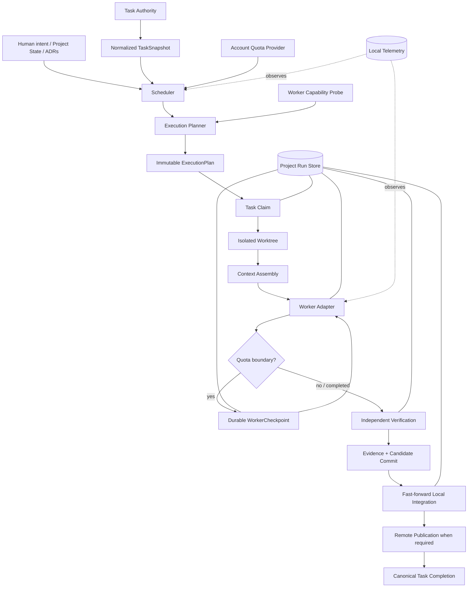

# ProjectCTL Blueprint

Status: **Canonical high-level product, architecture, and roadmap reference**

Last architecture review: **2026-10-04**

This document answers four questions:

1. What is ProjectCTL ultimately trying to become?
2. Which component is authoritative for each kind of state?
3. What architecture and safety invariants must future work preserve?
4. What is implemented now, what is deliberately not implemented, and what should happen next?

It is intentionally different from the README and ADRs:

- `README.md` is the user-facing implementation guide and milestone history.
- `docs/PROJECT_STATE.yaml` is the **only authority for the active goal and active milestone**.
- ADRs are the authority for individual architecture decisions. A newer accepted ADR overrides
  a conflicting statement here and this blueprint must then be updated.
- This blueprint is the authority for the **overall product direction, architecture map, invariants,
  and roadmap shape**.

Do not create a second roadmap, task tracker, or execution-state authority beside these sources.

---

## 1. Product vision

ProjectCTL is a:

> **local-first, Git-native, task-centric, evidence-driven, quota-aware control plane for
> AI-assisted software engineering.**

The final product is not an unconstrained autonomous coding agent.

It is a deterministic control plane that can take an existing or new software repository,
discover its existing authorities, choose bounded work, delegate implementation to one or more
worker providers, independently verify the result, integrate only proven changes, survive
interruptions, respect model quota, and keep humans in control of intent and policy.

The intended user experience is approximately:

```text
projectctl init / adopt
        ↓
discover project authorities and constraints
        ↓
inspect current project state
        ↓
select eligible task deterministically
        ↓
build immutable execution plan
        ↓
claim task
        ↓
create isolated worktree
        ↓
assemble bounded context
        ↓
run worker
        ↓
checkpoint safely if quota requires it
        ↓
independent verification
        ↓
create verified candidate commit
        ↓
integrate under control-plane policy
        ↓
publish when remote/team semantics require it
        ↓
complete canonical task
        ↓
refresh status / continue or stop
```

A future ProjectCTL may coordinate multiple projects and multiple workers, but only after the
single-project lifecycle is correct and observable.

---

## 2. Non-goals

ProjectCTL must not become:

- a second source of truth for requirements that already live elsewhere
- a hidden replacement for the configured task tracker
- an LLM-driven scheduler whose decisions cannot be reproduced
- a worker that verifies its own claims
- a daemon that consumes unbounded quota
- a system that silently rebases or rewrites verified code
- a credential store for external providers when supported provider tooling already owns auth
- a prompt wrapper that approximates provider features the adapter cannot actually guarantee
- a distributed coordinator before a real distributed ownership primitive exists

---

## 3. Authority map

Exactly one authority should exist for each mutable concern.

| Concern | Authority | Notes |
| --- | --- | --- |
| Product vision / high-level architecture / roadmap shape | `docs/PROJECTCTL_BLUEPRINT.md` | This document |
| Active goal / active milestone | `docs/PROJECT_STATE.yaml` | Structured, human-managed |
| Requirements / feature specification | Bound project specification sources | Spec Kit when configured; otherwise project bindings |
| Architecture decisions | `docs/decisions/ADR-*.md` | Newer accepted ADR wins on conflict |
| Task execution state / dependencies | Configured task authority | Beads, GitHub Issues, Linear and Jira adapters implemented; exactly one provider per project |
| Code transport intent | `.projectctl/config.yaml -> code_transport` | Local Git or one explicitly pinned generic network Git remote; independent from task authority |
| Code delivery intent | `.projectctl/config.yaml -> code_delivery` | Local-only, explicitly authorized direct Git publication, or review-required delivery |
| Execution ownership | Resolved ownership strategy | Task-native, project-local exact claim, or generic remote Git ref lease |
| Source code and integration history | Git | Git state is never inferred from worker narration |
| Verification policy | `projectctl.verification.yaml` | Human-managed |
| Verification result / evidence | ProjectCTL run artifacts and Evidence manifests | Worker result alone is not evidence |
| Run lifecycle / leases / checkpoints | `.projectctl/state.sqlite` + run artifacts | Operational, project-instance-local |
| Quota observations / provider selection | `$PROJECTCTL_HOME/state.sqlite` | Account-global |
| Account execution admission | Future `$PROJECTCTL_HOME/state.sqlite` admission lease | M4.0a; account-global and distinct from project/task ownership |
| Project quota policy | `.projectctl/config.yaml` | Local policy, not quota observation/admission authority |
| Generated status dashboards | `docs/generated/*` | Derived and non-authoritative |
| Telemetry | `.projectctl/telemetry.sqlite` | Observational only |
| Graph data | Future derived Graphify integration | Must never become requirements/task authority |
| Obsidian or other UI | Future human cockpit | Must remain UI, not execution authority |

### Authority rule

If two systems can independently change the same semantic state, the architecture is wrong until
one is explicitly declared authoritative and the other is made derived, imported one-way, or
read-only.

This is why Spec Kit → Beads import is one-way, generated dashboards are non-authoritative, and
GitHub mutations are enabled only where ProjectCTL has explicit ownership, publication, and
non-destructive lifecycle semantics.

---

## 4. Core invariants

These are architecture constraints, not implementation preferences.

### 4.1 Human intent is a boundary

A change in project goal, active milestone, requirements, architecture policy, or protected
instructions is not ordinary worker input. Autonomous continuation must stop or replan.

### 4.2 Task and Run are different entities

A Task is durable project work owned by the configured task authority.

A Run is one ProjectCTL attempt to execute that task. A task may have many runs.

Run state must never silently become a second task tracker.

### 4.3 Scheduler and Execution Planner are separate

The scheduler ranks eligible work from normalized task state, project state, quota, and
deterministic policy.

Worker capability and execution strategy belong to the execution-planning layer, not task ranking.

### 4.4 Workers are not authorities

Workers may implement code and return structured results.

They may not authoritatively decide:

- which task is complete
- which files actually changed
- whether tests passed
- whether Git history is valid
- whether permissions may be expanded
- whether required verification may be weakened
- whether a task may be closed

### 4.5 Verification is independent

Required verification is selected by trusted ProjectCTL/human policy and runs independently of
worker self-report.

A task is not complete until the required evidence chain is valid.

### 4.6 Verified code is not silently transformed

A verified candidate is bound to its exact base and exact diff.

Integration is fast-forward-only today. If the target advances, ProjectCTL does not silently
rebase/cherry-pick the candidate and pretend the old evidence still applies.

### 4.7 Worker Git authority is intentionally narrow

Workers may modify the isolated workspace permitted by policy.

Workers may not commit, merge, rebase, push, or rewrite Git history. ProjectCTL owns control-plane
Git mutations.

### 4.8 Quota is account-global; policy is project-local

Quota observations belong to the provider account, not one repository.

Project policy may reserve or constrain that shared budget, but repositories must not maintain
independent fictional copies of account quota.

### 4.9 Unknown state fails closed

Unknown capability, stale quota, ambiguous recovery state, conflicting task metadata, unsafe path,
or unproven ownership must not be converted into optimistic execution.

### 4.10 Provider support is not adapter support

A provider feature is usable only when ProjectCTL has an adapter path whose semantics are tested
and compatible with ProjectCTL policy.

### 4.11 Context must be inspectable and bounded

Context assembly records authoritative paths and digests rather than dumping the entire project
into prompts.

Future context discovery may become smarter, but it must remain distinct from authority.

### 4.12 Autonomous execution is bounded

M2 deliberately implements a synchronous bounded loop, not an infinite daemon.

Quota checks, retry budgets, recovery-first behavior, and human-decision stops remain part of the
safety boundary.

### 4.13 Task authority, code transport, ownership, and delivery are separate axes

The configured task tracker does not determine where source code is hosted.

Valid architecture combinations include:

- Beads + local Git
- Linear + local Git
- Linear + GitLab
- Linear + GitHub
- GitHub Issues + another Git host, subject to completion/delivery policy

A task provider may expose no safe claim primitive while ProjectCTL still has a separate execution
ownership strategy.

Likewise, the existence of a Git remote does not mean ProjectCTL is allowed to publish to it.

Local-only means a local Git repository without a network remote. The current execution model is
Git-native and does not support a completely non-Git workspace.

---

## 5. Current architecture



The `Publish` stage is selected by Code Delivery policy, not Task Authority. Local delivery can
complete from verified local integration; `direct_git` requires exact-base remote publication and
durable observation; `review_required` uses supported GitHub PR / GitLab MR adapters and completes
only after external merge plus independent exact-candidate/ancestry proof.

---

## 6. Layer boundaries

### 6.1 Project layer

Responsibilities:

- initialize/adopt repositories
- discover existing project assets
- bind knowledge sources
- hold structured Project State
- protect human/tool/generated ownership boundaries

Must not:

- infer missing intent with an LLM
- rewrite existing project structure merely to fit ProjectCTL

### 6.2 Task-authority layer

Responsibilities:

- normalize provider-specific tasks into `NormalizedTask`
- read canonical task state
- expose provider-native lifecycle mutation capabilities only when semantics are proven
- perform task-state block/complete mutations only when they preserve provider authority

Task authority does **not** imply code hosting or execution ownership.

Provider-specific behavior must stay behind task-authority ports/resolvers.

Application services must not import Beads/GitHub/Linear/Jira implementations directly.

### 6.3 Execution-ownership layer

Responsibilities:

- select an ownership strategy independently from task-provider identity
- provide exact claim/reconcile/validate/release semantics
- distinguish local-only ownership from distributed ownership
- bind durable TaskClaim evidence to one task/run/request
- fail closed when remote identity or exact ownership evidence changes

Implemented strategies:

- Beads task-native claim
- ProjectCTL local exact claim marker for `code_transport.mode=local`
- generic network Git remote-ref lease for `code_transport.mode=git_remote`

The generic Git strategy is hosting-vendor-neutral. GitHub, GitLab, or a compatible self-hosted Git
remote may provide the transport, subject to that remote's own branch/rules permissions.

### 6.4 Scheduling layer

Responsibilities:

- deterministic eligibility
- deterministic scoring
- stable tie-breaking
- quota-aware model-profile recommendation
- milestone relevance from explicit metadata

Must not:

- mutate task state
- inspect provider credentials
- use worker capability to change task ranking
- invent quota or cost estimates

### 6.5 Execution layer

Responsibilities:

- immutable plan creation
- preflight revalidation
- canonical task claim
- worktree lifecycle
- execution policy
- worker capability/strategy validation
- durable run transitions

### 6.6 Worker layer

The worker boundary is provider-neutral.

Current implemented worker provider: **Codex**.

The stable adapter currently relies on documented supported surfaces. Provider features not
implemented by the adapter remain unsupported rather than prompt-emulated.

### 6.7 Verification and evidence layer

Responsibilities:

- protected-path checks
- deterministic configured commands
- workspace-stability checks
- evidence chain
- ProjectCTL-owned candidate commit

### 6.8 Integration/publication layer

Current local integration:

- exact-base validation
- evidence revalidation
- fast-forward only
- serialized shared-target mutation
- no worker Git mutation

Current delivery behavior:

- `code_delivery` is independent from Task Authority and Code Transport
- `local` completes from passing EvidenceManifest after exact local integration
- `direct_git` publishes the exact verified candidate to the pinned generic Git remote
- PublicationRequest/PublicationManifest form the durable direct-publication evidence chain
- generic Git publication is exact-base and fast-forward-only using force-with-lease semantics
- remote identity is validated independently from task-provider identity
- `review_required` is implemented for GitHub.com pull requests and GitLab.com merge requests
- review creation is not completion; ProjectCTL waits for external merge and independently proves
  exact candidate/ancestry before canonical task completion
- ProjectCTL never auto-merges or falls back from review-required delivery to direct push
- ownership release is selected by Execution Ownership rather than provider delivery flags
- GitHub completion remains additive via `projectctl:completed`
- Linear completion is additive through reserved team-scoped ProjectCTL lifecycle labels
- Jira completion is additive through filtered compare-and-set issue properties
- none of the remote lifecycle adapters overwrite native human workflow state to express
  ProjectCTL completion

Repositories whose review or branch policy cannot be proven through a supported adapter fail closed.

### 6.9 Runtime/recovery layer

Responsibilities:

- local leases
- lease heartbeat
- crash-safe project locks
- append-only run events
- deterministic recovery
- resumable quota checkpoints

Current locks and leases are project-instance-local unless a provider-specific distributed
primitive is explicitly introduced.

### 6.10 Telemetry/evaluation layer

Current telemetry is a local SQLite event stream.

It is useful for audit and later evaluation, but it is not yet a distributed tracing or OTLP
system and must not be described as one.

---

## 7. Runtime lifecycle today

The implemented single-project lifecycle through M3.3c is:

```text
fresh state
  ↓
scheduler decision
  ↓
ExecutionPlan
  ↓
execution-readiness gate
  ├─ unsupported task lifecycle / ownership / delivery → STOP before claim
  └─ ready
       ↓
    durable task claim
       ↓
    isolated worktree
       ↓
    ContextManifest + WorkerRequest
       ↓
    Codex turn
      ├─ quota unsafe → interrupt → durable checkpoint → later resume same thread
      └─ implemented
             ↓
          VERIFYING
             ↓
       independent verification
             ↓
       verified candidate commit
             ↓
       READY_TO_INTEGRATE
             ↓
       ff-only local integration
             ↓
       delivery mode
         ├─ local
         │    ↓
         │  canonical task completion from EvidenceManifest
         │
         ├─ direct_git
         │    ↓
         │  durable PublicationRequest
         │    ↓
         │  exact-base remote publication
         │    ↓
         │  remote candidate observation
         │    ↓
         │  durable PublicationManifest
         │    ↓
         │  canonical task completion
         │
         └─ review_required
              ↓
            durable ReviewRequest
              ↓
            PR/MR open → AWAITING_REVIEW
              ↓
            external merge
              ↓
            exact candidate + ancestry proof
              ↓
            durable ReviewReceipt
              ↓
            canonical task completion
             ↓
       independent claim release when applicable
             ↓
           PASSED
```

`review_required` uses durable ReviewRequest/ReviewReceipt artifacts and waits in AWAITING_REVIEW
until an external GitHub/GitLab review merge can be independently proven.

Beads, GitHub Issues, Linear and Jira may execute when their configured ownership and delivery
modes are supported. GitHub completion requires remote-visible delivery evidence. Linear uses
crash-safe additive lifecycle labels; Jira uses crash-safe filtered-CAS lifecycle properties.
Review-required GitHub.com/GitLab.com repositories wait for external review/merge and remain
fail-closed on unsupported hosts or unprovable merge transformations.

---

## 8. Current implemented baseline

### M0 — deterministic control plane

Implemented:

- schemas/contracts
- project bootstrap and doctor
- Beads task reader/import integration
- adaptive brownfield onboarding
- deterministic scheduler and quota-aware model profiles
- structured Project State
- generated status dashboards

### M1 — safe single-run execution

Implemented:

- immutable execution contracts
- claims and durable Run Store
- isolated external worktrees
- Codex capability/strategy layer
- deterministic path-based context assembly
- stable Codex worker adapter
- independent verification and evidence
- ProjectCTL-owned candidate commits
- fast-forward integration
- deterministic recovery
- lease heartbeat and project integration locks

### M2 — bounded autonomy and quota safety

Implemented:

- bounded synchronous auto loop
- recovery-first orchestration
- bounded retry
- automatic official Codex quota observations
- account-global quota provider selection
- in-turn quota monitoring
- supported Codex interrupt/resume
- durable tamper-evident checkpoints

### M3.0a — GitHub read authority

Implemented:

- GitHub Issues read adapter
- GitHub repository discovery/pinning
- GitHub issue normalization
- scheduler/status reads against GitHub
- read-only doctor checks
- explicit execution fail-closed boundary
- additive config/onboarding schema versioning

### M3.0b1 — provider-neutral task authority boundary

Implemented:

- TaskAuthorityCapabilities v1
- one Task Authority resolver
- provider-neutral application task reads/claims/lifecycle completion access
- static adapter capability inspection
- CLI capability inspection
- architecture guard preventing direct task-provider imports in application services

### M3.0b2 — distributed GitHub claim ownership

Implemented:

- exact remote-ref claim/release CAS
- unique marker commit ownership
- durable TaskClaimRequest/TaskClaim evidence
- claim validation before worker start/resume
- partial-prepare crash recovery

### M3.0c — publication-gated GitHub delivery

Implemented:

- provider-neutral delivery policy and publisher port
- exact-base remote publication
- durable publication evidence/recovery
- additive non-destructive GitHub completion/decision markers
- publication-bound task completion
- publication proof independently revalidated by the GitHub completion adapter
- claim release only after remote delivery/task completion
- post-completion claim cleanup cannot rewrite canonical task semantics
- GitHub full execution gate enabled under the direct-publication policy


### M3.1a — GitHub structured team relationships

Implemented:

- native blocked-by dependency normalization
- cross-repository unresolved dependency safety
- sub-issue hierarchy without implicit blocking semantics
- relation cycle/missing-node fail-closed validation
- TaskSnapshot v2 hierarchy contract


### M3.1b — GitHub core team metadata

Implemented:

- assignee/team observation without ownership semantics
- native issue-type classification and conflict handling
- milestone due-date scheduling input
- TaskSnapshot v3
- explicit deferral of Projects/custom Issue Fields

### M3.1c1 — GitHub derived cache foundation

Implemented:

- cache request/entry public contracts
- integrity-checked freshness provenance
- explicit API representation pinning
- disposable project-local storage and invalidation
- conditional-request-ready validators without cache-backed reads yet

### M3.1c2 — Conditional GitHub reads

Implemented:

- authenticated single-response conditional GETs through `gh api --include`
- ETag-first revalidation with Last-Modified fallback
- explicit 200 / 304 / provider-error handling
- 304 freshness advancement without payload replacement
- 200 payload/validator replacement
- cache-read telemetry for miss, refresh, revalidation and provider failure
- no stale-cache outage fallback

### M3.1c3 — Cache-backed snapshot assembly and scale

Implemented:

- ProjectConfig v3 with explicit task-store `cache_max_age_seconds`
- page-aware Issue and relation collection reads
- bounded local `fresh_hit` reuse of remotely validated pages
- automatic return to conditional revalidation after freshness expires
- repository-cache invalidation after successful Issue task mutation
- execution preflight override with cache max-age zero before and after claim
- scale tests proving repeated snapshots eliminate repeated relation GET fan-out

### M3.1d — Schema export authority and drift policy

Implemented:

- `PUBLIC_SCHEMAS` and versioned model classes are the sole implementation authority
- legacy partial `schemas/generated/` mirror removed from Git
- default generated schema directory ignored by Git
- deterministic schema filename export order
- CI rejects reintroduced checked-in generated schema mirrors
- CI exports the complete registry to a temporary directory and validates exact filenames/JSON

### M3.2a — Linear read authority

Implemented:

- Linear GraphQL read adapter scoped to one configured team UUID
- runtime-only LINEAR_API_KEY / LINEAR_ACCESS_TOKEN credentials
- cursor-paginated team Issue snapshots
- GraphQL partial-error fail-closed handling
- ProjectConfig v4 with additive task_store.team
- AdoptionPlan/Manifest v3 with Linear team scope
- static Linear capability report: read supported; all lifecycle writes unsupported
- non-terminal Linear issues withheld from READY eligibility
- execution remains fail-closed for Linear
- doctor/readability checks without credential persistence

### M3.2b — Linear relationship and eligibility semantics

Implemented:

- independently paginated incoming Linear issue relations
- incoming `blocks` relations normalized as canonical blocked-by dependencies
- terminal blockers treated as satisfied
- cross-team open blockers represented with stable external identities
- missing same-team blockers and ambiguous relation metadata fail closed
- local reverse `blocks` edges derived from canonical dependencies
- parent pointers normalized as hierarchy only; local sub-issues derived in reverse
- dependency and hierarchy cycle detection
- unstarted + no unresolved blocker becomes READY
- unstarted + unresolved blocker becomes BLOCKED
- backlog remains PLANNED
- Linear lifecycle writes remain unsupported

### M3.2c1 — Execution transport and ownership boundary

Implemented by the current change:

- ProjectConfig v5 adds code transport independently from task authority
- local Git and generic network Git remote modes
- credential-free canonical remote identity
- provider-neutral ExecutionOwnershipPolicy v1
- project-local exact claim strategy for remote task authorities without a Git remote
- generic remote Git ref lease strategy independent of hosting vendor
- historical GitHub claim namespace compatibility
- execution/recovery/release paths resolve ownership independently from Task Authority
- generic remote identity discovery during brownfield inspection
- AdoptionPlan/Manifest v4 code transport intent
- doctor separates task-provider health from ownership-transport health
- `projectctl execution-ownership` inspection command
- Linear remains non-execution-ready because task completion mutations are still unsupported

---

## 9. Architecture review findings — 2026-10-04

The M0–M2 core is coherent. The main risk is no longer the worker loop itself; it is extending the
system to external team authorities without weakening earlier invariants.

### Finding A — task provider abstraction was incomplete (resolved in M3.0b1)

The repository already defines `TaskStoreReader`, `TaskClaimer`, and
`TaskCompletionWriter` ports, but application code still directly imports and branches on Beads
in execution, integration, and terminal task reconciliation.

This is acceptable historical M1 code but is the wrong foundation for GitHub/Linear/Jira.

**Resolution:** M3.0b1 introduced one provider-neutral Task Authority resolver/capability layer,
and application services now depend on the ports rather than provider implementations.

### Finding B — GitHub issue mutation did not provide a claim CAS (claim ownership resolved in M3.0b2)

GitHub supports normal issue/label/assignee mutation, but those APIs do not provide ProjectCTL a
documented compare-and-swap ownership primitive.

Therefore labels/assignees alone must not be treated as an atomic claim.

M3.0b2 implements claim ownership with a reserved remote Git branch and exact Git
`--force-with-lease` semantics. Each claim points to a unique marker commit, making release
ownership-verifiable and ABA-safe. The claim request/result are also bound to durable run events.

This resolved claim/release ownership only at M3.0b2. M3.0c subsequently adds
publication-gated block/completion semantics.

### Finding C — local integration was insufficient for remote completion (resolved in M3.0c)

M1.4 local fast-forward integration alone was not team-visible delivery.

**Resolution:** M3.0c introduces a versioned TaskDeliveryPolicy plus durable
PublicationRequest/PublicationManifest artifacts. GitHub completion is allowed only after the exact
verified candidate is observed on the configured remote target.

ProjectCTL also avoids blind native Issue-state PATCHes. It records additive
`projectctl:completed` / `projectctl:needs-decision` markers so concurrent human close reasons
remain authoritative.

### Finding D — GitHub dependency semantics were absent (resolved in M3.1a)

M3.0a originally left `dependencies=[]` and `blocks=[]` for GitHub Issues.

**Resolution:** M3.1a consumes GitHub's structured blocked-by API, derives reverse blocks edges,
models sub-issue hierarchy separately, and fails closed on missing/cyclic relationship state.

### Finding E — autonomous execution remains single-active-run

M2 intentionally stops if multiple active runs exist.

Parallel execution and multi-agent orchestration are **not** implemented and should not be
described as current capabilities.

The post-M3 review confirmed this is not merely a loop-policy limitation. Current plans bind the
whole semantic TaskSnapshot, verified candidates are exact-base, and integration targets are
serialized. Safe parallelism therefore requires scoped execution inputs, conflict/resource scopes
and a transformed-candidate reverification contract before the multiple-active-run stop can be
removed.

### Finding F — advanced context/skills/graph features are still future work

The architecture anticipated:

- Context Discovery separate from Context Assembly
- optional Graphify-derived code relationships
- a governed skill lifecycle
- research/hypothesis/experiment flows

The current repository implements deterministic Context Assembly only. These future capabilities
must not be assumed by scheduling or execution code.

### Finding G — telemetry is intentionally minimal

Telemetry is currently a local SQLite event log. OTLP/distributed tracing/evaluation infrastructure
is future work.

### Finding H — generated public schemas needed an explicit drift policy (resolved in M3.1d)

The repository previously contained a partial checked-in `schemas/generated/` mirror that had
drifted behind the public exporter registry.

**Resolution:** ADR-020 makes `projectctl.schema_export.PUBLIC_SCHEMAS` plus the versioned model
classes the sole implementation authority. Generated schema files are now disposable export/build
artifacts, `schemas/generated/` is ignored and not versioned, export order is deterministic, and
CI rejects a checked-in mirror while validating the complete exporter output in a temporary
directory.


### Finding I — account-global quota observation lacks account-global execution admission

Quota provider selection/observations already live in `$PROJECTCTL_HOME/state.sqlite`, but each
project still performs execution admission independently.

Two project roots sharing one account can therefore evaluate the same fresh quota state and both
start quota-consuming worker turns.

**Decision:** M4.0a introduces an account-global execution admission lease before portfolio
scheduling or parallel execution. The first version is exclusive per quota account because
ProjectCTL does not yet have a trustworthy per-task token-cost estimator.

### Finding J — portfolio/global orchestration groundwork exists but is not yet authoritative

The global DB already contains a stable `project_registry`, but no global scheduler or arbitration
artifact exists.

Project-local scheduler scores are policy-local and must not be treated as directly comparable
global utilities.

**Decision:** M4.0b will arbitrate among project-level candidate envelopes after M4.0a provides an
atomic account admission primitive. Each project's scheduler remains authoritative for task choice
inside that project.

---

## 10. Roadmap

Completed milestone history is documented in README and ADRs. This section is about the next
architecture sequence.

### M3.0b1 — Task Authority Capability & Resolver Layer

**Completed.**

Goal: remove provider-specific task lifecycle logic from the application layer before adding more
remote writes.

Deliverables:

- one Task Authority resolver
- explicit capability artifact/model for read/claim/release/block/complete
- Beads resolved as fully execution-capable
- GitHub resolved as read-only
- application code depends on ports/resolver, not provider implementation imports
- architecture test preventing provider-specific task imports in application services
- no GitHub remote mutation yet

### M3.0b2 — GitHub Remote Claim Protocol

**Completed.**

Goal: establish concurrency-safe GitHub claim ownership without enabling remote completion.

Implemented:

- reserved `refs/heads/projectctl/claims/issue-N` namespace
- unique marker commit per claim request
- absent-only CAS acquisition using explicit Git force-with-lease
- exact expected-SHA CAS deletion
- successful-release / immediate-reacquire race handling
- ABA-safe stale-release rejection
- post-claim execution-input revalidation
- remote target/base equality precondition
- origin repository identity validation
- durable `TaskClaimRequest v1` and `TaskClaim v1`
- claim artifact digests anchored in append-only run events
- safe retry/abort release from durable ownership evidence
- legacy Beads-only release compatibility for pre-M3.0b2 runs
- GitHub claim/release capabilities marked supported
- GitHub block/complete remain unsupported, so GitHub is still not execution-ready

No GitHub Issue completion occurs in this milestone.

### M3.0c — Remote Publication & GitHub Completion

**Completed.**

Goal: make remote/team completion depend on provable remote-visible delivery without overwriting
concurrent human workflow intent.

Implemented:

- `TaskDeliveryPolicy v1`
- `PublicationRequest v1` and `PublicationManifest v1`
- exact-base remote CAS publication with remote observation
- stale/diverged remote target fail-closed behavior
- publication artifacts anchored in run events
- `IntegrationManifest v2` with publication evidence
- publication-aware INTEGRATING crash recovery
- GitHub additive `projectctl:completed` marker
- GitHub additive `projectctl:needs-decision` marker
- native GitHub close reasons remain authoritative
- exact GitHub claim held through publication/completion, then released
- full GitHub task-authority execution capability under direct-publication policy

Direct PR creation/merge is not implemented; repositories that require PR-only delivery remain
policy-blocked rather than bypassed.

### M3.1a — GitHub Dependencies & Sub-issues

**Completed.**

Implemented:

- native GitHub blocked-by relationships normalized into scheduler dependencies
- reverse blocks edges derived from the canonical blocked-by graph
- open cross-repository dependencies fail closed through stable external identities
- closed/completed external dependencies are treated as satisfied
- sub-issue parent/child hierarchy represented separately from dependencies
- dependency and hierarchy cycle detection
- missing/ambiguous relation fail-closed behavior
- TaskSnapshot v2 with additive v1 compatibility

### M3.1b — GitHub Team Metadata

**Completed.**

Implemented:

- deterministic assignee normalization as observational team context
- native GitHub issue-type normalization with explicit conflict precedence
- rich native milestone metadata
- GitHub milestone due date mapped to scheduler `due_at`
- team-only metadata excluded from execution/scheduler semantic digest
- TaskSnapshot v3 with additive v1/v2 compatibility
- custom Issue Fields and Projects V2 deliberately excluded from implicit scheduling policy

Assignee/project metadata never becomes claim ownership.

### M3.1c1 — GitHub Derived Cache & Freshness Contract

**Completed.**

Implemented:

- versioned GitHubCacheRequest v1 and GitHubCacheEntry v1
- repository-scoped deterministic request fingerprints
- explicit GitHub API-version/media-type representation identity
- payload and freshness-provenance integrity digests
- observed_at vs validated_at semantics
- caller-supplied freshness evaluation
- atomic project-local derived-cache persistence
- exact-request and repository invalidation
- path-containment / symlink safety
- no SQLite migration and no task-authority duplication

This milestone does not yet reduce API calls.

### M3.1c2 — Conditional GitHub Reads

**Completed.**

Implemented:

- authenticated `gh api --include` response-envelope reads
- response ETag / Last-Modified capture for single-response GET representations
- `If-None-Match` preferred when ETag exists
- `If-Modified-Since` fallback when ETag is absent
- `304 Not Modified` revalidation that preserves payload, payload digest and `observed_at`
- `200 OK` replacement of payload and validator provenance
- provider/transport/API failures remain errors even when derived cache data exists
- cache-read telemetry distinguishes `miss_200`, `refreshed_200`,
  `revalidated_304` and `provider_error`
- validator header line-break rejection before request construction
- no TTL-based local fresh hit and no multi-page aggregate validator reuse

A `gh api --paginate --slurp` result is not treated as one HTTP representation. Existing
multi-page Issue/relation reads remain unconditional in M3.1c2 so a validator from one response
cannot incorrectly validate an aggregate. Page-aware reuse belongs to M3.1c3.

### M3.1c3 — Cache-backed Snapshot Assembly & Scale

**Completed.**

Implemented:

- ProjectConfig v3 with explicit `task_store.cache_max_age_seconds`
- v1/v2 project configs remain readable and upgrade in memory
- `0` disables local fresh hits and forces remote revalidation
- Issue lists and relationship collections are fetched/cached as independent concrete pages
- each page has an independent request fingerprint, payload digest, validators and freshness proof
- fresh validated pages may be reused without another immediate GitHub request
- stale pages return to the M3.1c2 ETag/Last-Modified conditional path
- provider/API failure after revalidation is attempted remains an error; stale cache is not an
  outage fallback
- successful Issue lifecycle-label mutation invalidates repository-derived cache before reread
- ordinary status/scheduling reads may use bounded freshness, while execution preflight before
  and after claim forces `max_age=0` remote validation
- scale tests measure request-count reduction across repeated snapshots and per-Issue relation
  fan-out
- GitHub remains authoritative; cache remains disposable derived operational state

### M3.1d — Schema Export Authority & Drift Policy

**Completed.**

Implemented:

- public JSON Schema implementation authority is `PUBLIC_SCHEMAS` plus its versioned model classes
- legacy partial `schemas/generated/` mirror removed
- `schemas/generated/` ignored so normal local export does not dirty Git
- deterministic filename ordering in `export_json_schemas`
- CI fails if a generated schema mirror is checked back into the repository
- CI exports every registered schema to a clean temporary directory and verifies exact registry
  coverage plus JSON/schema-object shape
- ADR-020 records the policy and future release-artifact boundary

### M3.2 — Additional task authorities

Linear and Jira reuse the same Task Authority ports/capability model, but provider semantics are
proven incrementally rather than assumed from GitHub.

#### M3.2a — Linear Read Authority

**Completed.**

Implemented:

- official Linear GraphQL endpoint with personal API-key or OAuth access-token authentication
- credentials remain runtime-only environment input and are never persisted by ProjectCTL
- one configured Linear team UUID is the task-authority scope
- Relay-style cursor pagination with cursor-progress validation
- GraphQL `errors` fail closed even when HTTP 200 contains partial data
- returned team identity is checked on every page
- ProjectConfig v4 adds `task_store.team`; v1-v3 remain readable through in-memory upgrade
- AdoptionPlan/AdoptionManifest v3 carry team scope additively
- Linear workflow categories normalize terminal/running observations
- backlog/unstarted issues remain `PLANNED`, never `READY`, until dependency semantics exist
- Linear capabilities report read=supported and all lifecycle mutations=unsupported
- execution gate therefore remains fail-closed
- doctor can prove credential/team readability without performing a mutation

Deliberately not implemented in M3.2a:

- Issue blocking/blocker normalization
- parent/sub-issue normalization
- webhook synchronization or derived cache
- claim/release ownership
- lifecycle/needs-decision/completion mutations
- delivery/publication semantics
- Jira

#### M3.2b — Linear Relationship & Eligibility Semantics

**Completed.**

Implemented:

- read incoming `inverseRelations` independently per issue using Relay cursor pagination
- treat only relation type `blocks` as a scheduling dependency
- interpret the inverse relation source issue as the blocker and verify the requested issue is the
  target before accepting the edge
- treat completed/canceled blockers as satisfied
- represent unresolved cross-team blockers with stable `linear:<UUID>` external identities
- fail closed when an unresolved blocker claims the configured team but is absent from the team
  snapshot
- fail closed on unknown/missing relation types, missing state/team identity, target mismatch and
  relation-direction ambiguity
- derive local reverse `blocks` edges from canonical dependencies
- normalize Linear parent pointers into hierarchy without implicit blocking
- derive local sub-issue lists from parent pointers
- detect dependency and hierarchy cycles
- preserve `backlog -> PLANNED`
- allow `unstarted -> READY` only when no unresolved dependency or human-decision condition exists
- map `unstarted + unresolved dependency -> BLOCKED`
- keep Linear mutation capabilities unsupported, so scheduler visibility does not imply execution
  readiness

#### M3.2c1 — Execution Transport & Ownership Boundary

**Completed.**

The earlier "Linear claim" framing was too narrow because task authority and code host are
independent.

Implemented:

- ProjectConfig v5 adds explicit `code_transport`
- `local` mode requires no network Git remote
- `git_remote` mode pins a remote name plus credential-free `host/path` identity
- v1-v4 project configs remain readable; existing GitHub configs migrate to
  `origin -> github.com/<owner>/<repo>` to preserve historical behavior
- brownfield inspection detects generic origin identities including GitLab/self-hosted Git
- AdoptionPlan/Manifest v4 persist code transport intent independently from task-provider scope
- `ExecutionOwnershipPolicy v1` makes effective ownership inspectable
- Beads retains task-native ownership
- local mode gives non-Beads providers a project-filesystem exact claim marker
- git-remote mode gives non-Beads providers an exact remote Git ref lease
- generic Git ownership validates configured remote identity before every remote operation
- GitHub's historical ref namespace remains compatible
- execution preparation, validation, recovery and release resolve the ownership strategy rather
  than asking Task Authority to own the claim
- doctor validates Task Authority and Execution Ownership separately
- Linear may now have a proven ownership strategy but remains execution-disabled because
  canonical Linear lifecycle writes are still unsupported

Safety boundary:

- local ownership protects processes sharing the same ProjectCTL project filesystem only
- local ownership is not advertised as cross-machine distributed coordination
- a completely non-Git execution workspace remains unsupported
- generic Git ownership does not imply permission to publish verified code
- remote publication and task completion remain separate contracts

#### M3.2c2 — Generic Delivery & Linear Lifecycle

**Completed.**

Implemented:

- ProjectConfig v6 adds explicit `code_delivery`: `local`, `direct_git`, or
  `review_required`
- legacy GitHub direct-publication behavior migrates in memory without rewriting older config
- all other legacy remotes remain local-delivery unless the user explicitly authorizes publication
- CodeDeliveryPolicy v1 makes the effective delivery contract inspectable
- generic exact-base Git publisher validates credential-free remote identity and is independent
  from task-provider identity
- application integration resolves delivery separately from Task Authority
- local completion evidence uses EvidenceManifest
- direct-Git completion evidence uses PublicationManifest
- review-required delivery is modeled but fails closed before claim because no PR/MR adapter exists
- Linear reserves team-scoped `projectctl:completed` and `projectctl:needs-decision` labels
- Linear lifecycle writes use additive label mutations only
- native Linear completed/canceled state remains authoritative
- conflicting ProjectCTL Linear lifecycle markers normalize to NEEDS_DECISION
- Linear completion uses a fail-closed two-phase marker protocol: decision guard, completed marker,
  provider revalidation, then guard removal
- task state and incoming blockers are revalidated after completion staging
- ownership release follows the independent ownership strategy rather than historical delivery flags
- Doctor reports Task Authority, Execution Ownership, and Code Delivery independently

Safety boundary:

- ProjectCTL never infers publish permission from the existence of a Git remote
- ProjectCTL never overwrites Linear native workflow state to express completion
- ProjectCTL never replaces the full Linear label set
- a crash during Linear completion cannot leave a ProjectCTL-only DONE marker without the
  needs-decision guard
- direct Git publication that is rejected by branch/rules policy fails closed
- review-required repositories do not silently degrade to direct push

Linear is execution-ready when its configured ownership and delivery modes are themselves
execution-ready. Provider-native Linear claim/release remain unsupported because ProjectCTL
ownership is a separate axis.

#### M3.2c3 — Review-Aware Delivery Adapters

**Completed.**

Implemented:

- explicit active `AWAITING_REVIEW` run state
- durable `ReviewRequest v1` and `ReviewReceipt v1` contracts
- CodeDeliveryPolicy v2 with explicit review-provider capability
- IntegrationManifest v3 with review delivery evidence
- deterministic candidate-bound review source branches
- create-only remote review-branch publication; a pre-existing different SHA fails closed
- request-before-side-effect persistence and event anchoring
- reconcile-before-create review creation to survive create/persist crash windows
- built-in GitHub.com pull-request delivery through authenticated `gh api`
- built-in GitLab.com merge-request delivery through the GitLab REST API
- runtime-only GitLab credentials; ProjectCTL persists no GitLab token
- no automatic approval or merge
- open reviews keep task ownership and canonical task completion pending
- closed-unmerged reviews fail closed to NEEDS_DECISION
- merged reviews require exact candidate head plus independent Git ancestry proof
- fast-forward review merge acceptance when target equals candidate
- two-parent merge-commit acceptance only when parents are exactly verified base + candidate
- squash, rebase, stale-base, transformed-head, or ambiguous merge results require human decision
- local target reconciliation to the independently proven merged remote target
- canonical task completion receives only a completed ReviewReceipt as evidence
- recovery can repeatedly reconcile AWAITING_REVIEW until external merge occurs
- bounded auto mode stops with REVIEW_PENDING instead of launching another task
- host-specific review APIs remain behind review-delivery adapters

Safety boundary:

- creating a PR/MR is never treated as task completion
- ProjectCTL never auto-merges or bypasses provider review policy
- remote source branches are never force-replaced when they contain another commit
- provider `merged` state alone is insufficient without Git history proof
- old verification evidence is not reused across squash/rebase/stale-base transformations
- the exact execution claim remains held while external review is open
- unsupported/self-hosted review hosts fail closed before claim

With review-aware delivery proven for GitHub.com and GitLab.com, provider expansion reuses the
same read/lifecycle/ownership/delivery proof sequence.

#### M3.3a — Jira Read Authority

**Completed.**

Implemented:

- Jira Cloud project-scoped Task Authority for canonical `*.atlassian.net` sites
- ProjectConfig v7 with explicit `task_store.site` and `task_store.project`
- ProjectConfig v1-v6 migration in memory without rewriting persisted config
- runtime-only `JIRA_EMAIL` + `JIRA_API_TOKEN` authentication
- Jira REST v3 enhanced JQL search with explicit token pagination
- strict project-scope validation for every returned issue
- malformed/missing/repeated pagination-token failure handling
- task normalization for summary, type, priority, assignee, labels and timestamps
- conservative status-category normalization
- cancellation-like Jira resolutions -> CANCELLED
- in-progress categories -> observational RUNNING
- to-do/new categories -> PLANNED, never inferred READY
- unknown workflow categories -> NEEDS_DECISION
- parent/sub-task hierarchy normalization without dependency inference
- date-only Jira due dates preserved without inventing timezone-aware due timestamps
- Jira Task Authority capabilities expose read only; all lifecycle writes remain unsupported
- Doctor validates Jira project readability and enhanced-search access
- onboarding supports explicit Jira site/project identity

Safety boundary:

- Jira status categories are not treated as ProjectCTL execution policy
- M3.3a never transitions Jira workflow state
- M3.3a never mutates labels, assignee or issue properties
- Jira credentials are never persisted
- cross-project search leakage fails closed
- autonomous execution remains blocked because completion/needs-decision semantics are unproven

#### M3.3b — Jira Relationship & Workflow Eligibility

**Completed.**

Implemented:

- ProjectConfig v8 with explicit `task_store.jira_policy`
- READY policy pinned by Jira status id + name
- to-do/new status becomes READY only when explicitly allowlisted
- configured READY status drift in name/category -> NEEDS_DECISION
- issue-link policy pinned by type id, type name, inward label and outward label
- each configured link side maps explicitly to `dependency`, `blocks`, or `ignore`
- unknown/unconfigured Jira link types on a task fail closed to NEEDS_DECISION
- provider link metadata drift fails closed
- local dependency/blocks edges are materialized symmetrically from either observed link side
- unresolved local blockers move READY tasks to BLOCKED
- terminal blockers are treated as satisfied
- cross-project blockers use stable `jira:<site>:<issue-id>` identities
- cross-project blocker status is independently re-read before scheduler eligibility is released
- embedded external linked-issue status may be treated as stale but never as final authority
- cross-project id/key mismatch fails closed
- parent/sub-task hierarchy remains separate from dependency semantics
- dependency cycles and hierarchy cycles are detected independently and fail closed
- `projectctl jira-metadata` exposes current status/link metadata for deliberate policy authoring
- Doctor verifies configured READY statuses and link rules still match provider metadata
- Jira lifecycle capabilities remain read-only; execution is still fail-closed

Safety boundary:

- Jira status categories alone never grant READY
- link direction is never inferred from type name alone
- unknown/custom link semantics are never silently ignored
- parent hierarchy never blocks implicitly
- stale embedded cross-project blocker status cannot incorrectly unblock a task
- no Jira workflow mutation, issue-property write, claim or completion mutation occurs in M3.3b

#### M3.3c — Jira CAS Lifecycle

**Current milestone / implemented by this change.**

Implemented:

- public `JiraLifecycleMarker v1` contract
- reserved Jira issue-property key `projectctl.lifecycle.v1`
- lifecycle states `completion_pending`, `completed`, and `needs_decision`
- filtered Jira bulk issue-property mutation as a compare-and-set primitive
- absent-property creation guarded by `hasProperty=false`
- existing-property update guarded by exact `currentValue`
- every CAS scoped to one stable Jira numeric issue id
- asynchronous Jira mutation task is awaited before any subsequent lifecycle operation
- exact read-back verification after each mutation
- unexpected third-party property changes fail closed and are never overwritten
- two-phase completion guard: absent -> completion_pending -> completed
- durable evidence/run binding for pending/completed markers
- same-evidence crash recovery and idempotent completion retry
- malformed/foreign lifecycle property -> NEEDS_DECISION / mutation refusal
- native Jira workflow state is never transitioned by ProjectCTL
- native Jira terminal state remains authoritative
- completed marker is accepted as DONE only when current dependency/provider safety still holds
- current blocker or ambiguity can override a completed marker to NEEDS_DECISION in normalization
- Jira `block_for_decision` and `complete` capabilities are now supported
- Jira provider-native claim/release remain unsupported; independent local/Git ownership is used
- local, direct-Git, and review-required delivery modes can all feed Jira completion evidence
- Doctor reports CAS lifecycle capability without performing a destructive probe write

Safety boundary:

- ordinary last-write-wins Jira issue-property PUT is never used for lifecycle state
- native Jira workflow transitions remain human-owned
- ProjectCTL does not alter resolution, assignee, labels, summary, or description
- entity properties are treated as externally mutable; malformed/unexpected values are never repaired automatically
- a crash after the pending guard leaves NEEDS_DECISION rather than false DONE
- remote-success/local-crash windows are recovered from current marker + evidence identity
- Jira write permission is proven only by an actual lifecycle mutation

With M3.3c, Jira has completed the minimum execution proof sequence: read authority, explicit
eligibility/dependencies, additive lifecycle writes, independent ownership, and provider-neutral
delivery.

The next numbered milestone is intentionally not frozen here. A new architecture review should
choose among the post-M3 product directions rather than extending Jira work by default.

### M4 — Global Orchestration & Safe Concurrency

The post-M3 architecture review is recorded in
`docs/architecture/POST_M3_ARCHITECTURE_REVIEW.md` and ADR-029.

The sequencing rule is:

> establish account-global execution admission before portfolio arbitration, and establish both
> before enabling same-project parallel execution.

#### M4.0a — Account-Global Execution Admission

**Next milestone / frozen by the post-M3 architecture review.**

Goal: prevent independent projects sharing one quota account from concurrently admitting
quota-consuming worker turns against the same account-global quota observation.

Required work:

- global-state DB v2 with explicit migration/backup path
- authoritative account admission lease table in `$PROJECTCTL_HOME/state.sqlite`
- admission identity binds account, project instance, project id and run id
- atomic exclusive acquisition per account in the first version
- owner/heartbeat/expiry and deterministic stale-lease reclamation
- fresh quota revalidation while admission is held and before worker-provider contact
- no quota-consuming worker turn without a valid admission
- release on turn completion, checkpoint, failure and abort
- admission not held through verification/integration/publication/external-review waiting
- crash/recovery and audit events
- no fabricated token or percentage reservation

Non-goals:

- portfolio ranking
- multi-slot same-account concurrency
- token-cost prediction
- same-project parallel runs
- background daemon

#### M4.0b — Portfolio Scheduling & Cross-Project Arbitration

**Planned after M4.0a.**

Use the existing global project registry to decide which healthy project receives the next account
admission while preserving each project's local scheduler as the authority for task choice inside
that project.

Do not compare raw project-local scheduler scores as if they were globally equivalent.

#### M4.1a — Parallel Planning Safety Contract

**Planned after M4.0b.**

Define scoped execution-input digests, resource/write scopes, dependency/target conflicts and the
conditions under which two runs can be planned concurrently without invalidating each other's
proof inputs.

Optional Graphify-derived code relationships may contribute derived evidence here, but may not
become the sole conflict authority.

#### M4.1b — Safe Parallel Execution & Integration

**Planned after M4.1a.**

Allow bounded concurrent work only after independence is proven. Integration remains deterministic,
and any transformed/reapplied candidate requires fresh verification rather than reusing evidence
from the old exact-base candidate.

### Later product directions

Retained after the M4 correctness sequence:

- additional worker providers
- optional Graphify-derived code/context graph
- governed skills registry and supply-chain policy
- first-class Research / Hypothesis / Experiment / Evidence / Decision flows
- richer evaluation and trace export
- Obsidian or another human cockpit as a non-authoritative UI
- multi-agent orchestration only after safe concurrency semantics are proven

---

## 11. Rules for future architecture work

Before implementing a new feature, answer these questions:

1. **What is the authority?**
2. **Is this state project-local, account-global, provider-remote, or derived?**
3. **Is there a real atomic/ownership primitive, or are we assuming one?**
4. **What durable evidence proves the operation happened?**
5. **What happens if the process crashes between every pair of mutations?**
6. **Can another process/provider change this state concurrently?**
7. **Does this require a schema/version bump?**
8. **Does the worker actually support the capability, or only the provider/runtime?**
9. **Does completion mean local success or externally visible delivery?**
10. **What is the fail-closed behavior when any answer is unknown?**

A feature should not enter autonomous execution until these answers are explicit in code, tests,
and where necessary an ADR.

---

## 12. Documentation maintenance contract

When a milestone changes the architecture:

- add/update an ADR for the specific decision
- update this blueprint if the overall architecture, invariant, or roadmap changed
- update `docs/PROJECT_STATE.yaml` for the active goal/milestone
- update README for user-visible behavior
- version public/persisted schemas additively
- do not edit generated dashboards by hand

Workers must treat this document as human-managed architecture context.
